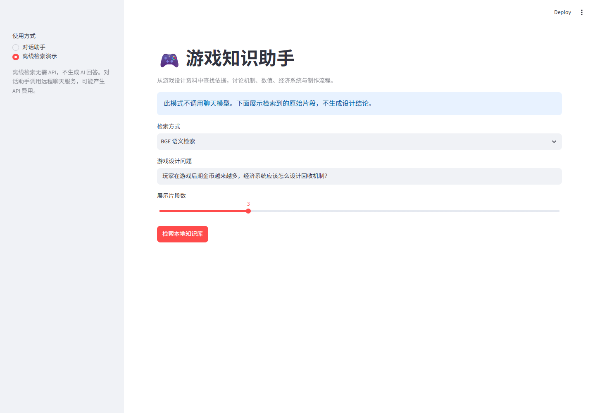
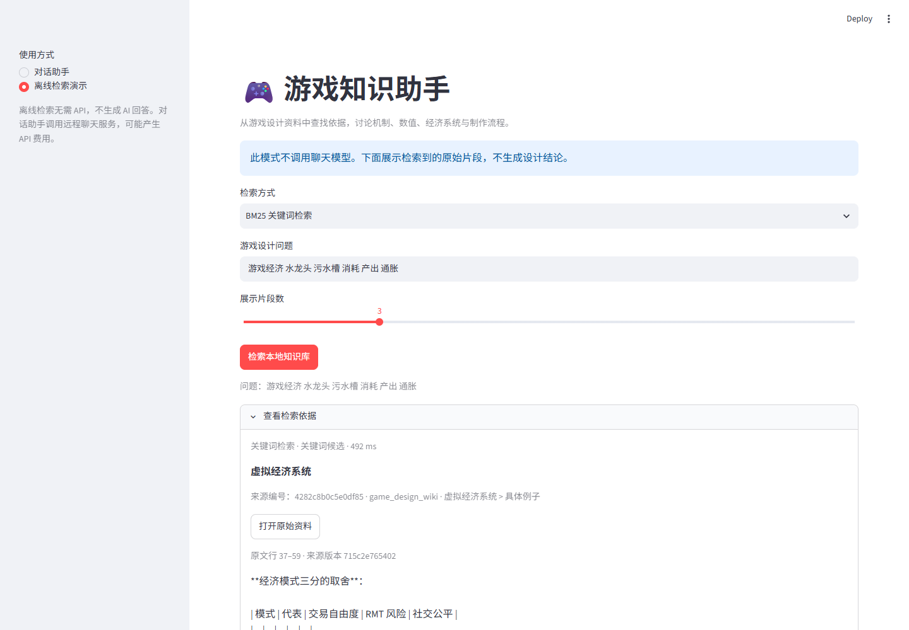
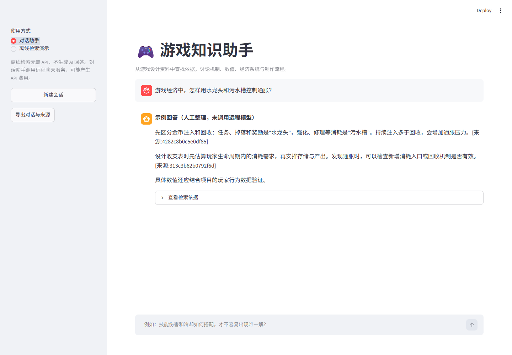

# 游戏知识助手

把分散的游戏设计资料变成可追溯的参考：查找机制、数值和经济系统的原文依据，再围绕同一个问题持续讨论。

| 模式 | 能得到什么 | 需要什么 |
| --- | --- | --- |
| 本地离线检索 | 原始资料片段和来源链接，不生成 AI 回答 | 无需 API；BM25 可直接使用 |
| AI 对话 | 带引用的回答、追问和历史导出 | 配置远程聊天服务；可能产生 API 费用 |

- **离线检索**：BGE 语义检索、BM25 关键词检索、RRF 混合检索。
- **来源展示**：查看原始片段、章节与来源链接。
- **连续对话**：LangGraph 工具调用、SQLite 历史保存、上下文摘要。
- **对话导出**：将回答与来源导出为 Markdown。

随仓库提供的知识库包含 4 个有许可声明的来源、5,285 个知识块。应用默认进入离线检索模式；启用对话助手需要配置聊天服务。



## 快速开始

需要 Python 3.10。Windows PowerShell 中先检查 `py -3.10 --version`；没有 `py` 时可使用 PATH 中的 Python 3.10，或向安装脚本传入 `-PythonExecutable`。

```powershell
.\scripts\setup.ps1
.\scripts\run.ps1
```

浏览器打开 `http://127.0.0.1:8501`，选择 **BM25 关键词检索**即可使用随仓库提供的 JSONL 语料。无需填写 API Key。

脚本被 PowerShell 阻止、依赖下载失败或端口冲突时，见 [安装与常见问题](docs/installation.md)。

使用 BGE 语义检索前安装模型依赖并构建索引：

```powershell
.\scripts\setup.ps1 -WithBge
.\.venv\Scripts\python.exe -X utf8 build_bge_combined_index.py
```

首次构建下载 `BAAI/bge-small-zh-v1.5`；运行时使用本地缓存。正文变化后使用 `--overwrite` 重建索引。

Linux/macOS 可创建虚拟环境、安装 `requirements.txt`，再运行：

```bash
python -m streamlit run UI.py --server.address 127.0.0.1
```

## 实际使用

例如输入“游戏经济 水龙头 污水槽 消耗 产出 通胀”，可以查看《虚拟经济系统》的相关章节，并打开对应原文。



配置聊天服务后可围绕资料继续追问。下面展示对话和引用的界面；**回答为人工整理的示例，未调用远程模型**。完整示例见 [使用示例](docs/demo.md)。



## 聊天配置

在 `.env` 中配置兼容 OpenAI 接口的聊天服务：

```dotenv
LLM_API_KEY=your_api_key
LLM_BASE_URL=https://your-provider.example/v1
LLM_MODEL=your_chat_model
RETRIEVAL_MODE=bge
```

`RETRIEVAL_MODE` 支持 `bge`、`keyword`、`hybrid`。可选配置 `METASO_API_KEY` 启用联网搜索，`VISION_*` 指定 OCR 模型。离线检索不需要这些接口。

## 项目结构

| 路径 | 功能 |
| --- | --- |
| `UI.py` | Streamlit 界面 |
| `Agent.py` | LangGraph 对话与工具编排 |
| `game_agent/` | 配置、提示词、文件访问与来源展示 |
| `wiki_corpus/` | 语料、向量索引与检索策略 |
| `conversation_*.py` | 历史存储与上下文管理 |
| `evals/` | 检索回归案例与实验结果 |
| `tests/` | 离线测试 |

## 测试与评估

```powershell
.\.venv\Scripts\python.exe -m pip install -r requirements-dev.txt
.\scripts\verify.ps1
.\.venv\Scripts\python.exe -X utf8 scripts/evaluate_retrieval.py --backend all --top-k 5 --output .runtime/retrieval_evaluation.json
```

测试使用临时数据库并阻断网络连接；[GitHub Actions](https://github.com/Ryuuson/Game-knowledge-agent/actions) 执行离线测试。检索评估使用本地模型与索引，不需要聊天 API。

30 条 AI 辅助构造回归案例（20 条游戏正例、10 条非游戏问题）上的结果如下。案例未经独立人工审核，标签未穷举所有相关资料，因此分数表示标注块召回，不能解释为回答准确率。

| 策略 | Recall@5 | 阈值后 Recall@5 | 非游戏拒答 | 游戏误拒 |
| --- | ---: | ---: | ---: | ---: |
| BGE | 57.5% | 42.5% | 10/10 | 5/20 |
| BM25 | 77.5% | 77.5% | 8/10 | 0/20 |
| BGE + BM25 / RRF | 70.0% | 50.0% | 10/10 | 5/20 |

当前回归集上，**BM25 对标注块的召回最好**。混合检索尚未显示整体优势；BGE 和混合路径减少了非游戏候选，但也误拒了一些游戏问题。进一步比较需要查询分析、独立相关性标注和留出数据验证。

实验环境、指标口径和失败案例见 [检索实验](docs/experiments.md)。

## 使用范围

应用面向本地单用户。聊天与摘要会将问题及必要上下文发送给配置的服务；凭据、会话、笔记和模型缓存保存在本机。

语义服务不可用时，界面明确显示关键词降级。来源编号核验只能确认引用来自检索结果；设计结论仍需结合原始资料与具体项目判断。资料来源及许可声明见 [知识库来源](docs/corpus-provenance.md)。

## 许可

项目原创代码和文档采用 [MIT](LICENSE)。第三方语料、评估中的引文和截图中的资料片段保留各自来源许可，见 [第三方声明](THIRD_PARTY_NOTICES.md)。未明确再分发许可的来源不随仓库附带。

## 文档

- [安装与常见问题](docs/installation.md)
- [使用示例](docs/demo.md)
- [系统架构](docs/architecture.md)
- [检索实验](docs/experiments.md)
- [知识库来源](docs/corpus-provenance.md)
