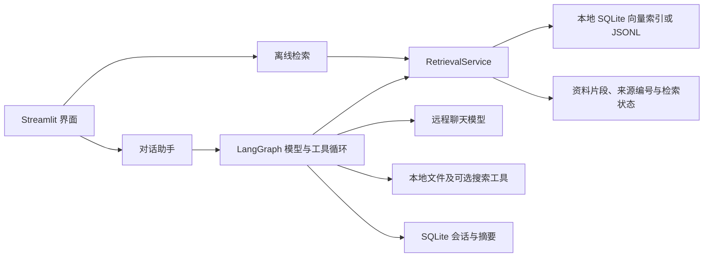

# 系统架构

应用有两条运行路径：离线检索直接返回本地资料，对话助手通过 LangGraph 调用模型和工具。两者共用 `wiki_corpus/retrieval.py` 中的检索服务。

## 检索与索引

BGE 索引将向量和来源元数据保存在 SQLite 中，首次检索时加载为归一化矩阵并缓存。查询使用同一模型编码，通过全量矩阵乘法和排序获得候选。当前语料为 5,285 个知识块，采用全量扫描可以直接复用本地存储，无需运行额外的向量服务。

BM25 从 JSONL 构建关键词索引，分词使用中文字符及相邻双字、英文词。混合检索用 RRF 合并 BGE 和 BM25 排名，再按 BGE 相似度筛选结果。三种策略的评估见 [检索实验](experiments.md)。

索引、模型缓存缺失或语义服务不可用时，检索回退到 JSONL/BM25，界面显示降级状态。主动选择 BM25 时返回 `keyword_only`；没有符合条件的片段时返回 `no_evidence`；领域规则识别出的非游戏问题返回 `out_of_domain`。

## 对话与上下文

LangGraph 在模型和工具之间循环。每个用户回合默认最多 6 轮工具请求，可配置为 1–12 轮；一轮可以包含多个工具调用。达到上限时提示并结束本回合，聊天请求默认超时 60 秒。

长对话通过保留近期完整回合、压缩较早历史为摘要来控制上下文长度。仍超出预算时，继续移除旧回合并缩短工具文本，无法容纳时返回错误。可配置的预算与保留回合数见 [.env.example](../.env.example)。

SQLite 保留原始会话历史和续聊摘要，支持恢复、切换与删除会话。引用展示使用实际检索记录，追问复用前一回合的资料时会标记证据来源回合。

## 配置与来源展示

`game_agent/settings.py` 读取并校验配置，`prompts.py` 定义回答与摘要规则，`local_files.py` 限制可访问的文件范围和读取量。

`game_agent/presentation.py` 整理最终回答，核对来源编号是否存在于检索记录中，并导出对话及来源。界面提供原文片段和链接供读者查看。

## 运行范围

应用面向本地单用户，未提供多用户账号和权限隔离。离线检索使用本地资料和模型缓存；首次构建 BGE 索引需要下载模型。聊天与摘要向配置的远程服务发送问题及必要上下文，可选联网搜索使用外部接口。
